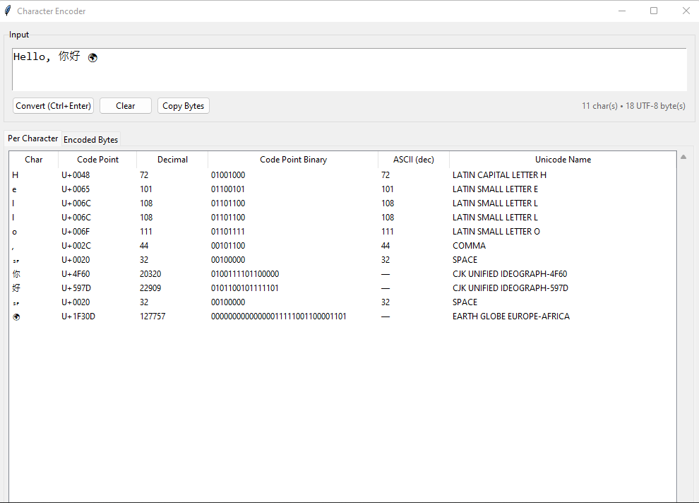

<div align="center">


**See any text — English, Chinese, emoji, or mixed — as ASCII, binary, hex, and encoded bytes.**

[](https://www.python.org/)
[](#)
[](tests/)
[](LICENSE)
[](#)

[Features](#-features) •
[Demo](#-demo) •
[Install](#-installation) •
[Usage](#-usage) •
[Architecture](#-architecture) •
[Testing](#-testing) •
[Contributing](#-contributing)

</div>

---

## 📖 Overview

**char-encoder** is a small, modular Python project that shows exactly how
text is stored at the byte level. Type any string — ASCII letters, Chinese
characters (Hanzi), emoji, or a mix — and instantly see:

- **Unicode code points** (`U+4F60`, decimal, binary)
- **ASCII values** where they exist (and a clear `—` where they don't)
- **Encoded bytes** in **UTF-8, UTF-16-BE, UTF-16-LE, GBK, and ASCII**, with hex and binary for each

It ships with **two front-ends** (a Tkinter GUI and a CLI) that share a
single, pure, fully-tested **core** module. The design keeps *logic* and
*interface* strictly separate — the core has **zero** GUI imports and can be
reused in scripts, notebooks, or servers.

> ⚠️ **Common misconception, corrected:** ASCII only covers code points
> `0–127`. Chinese characters like `你` (`U+4F60`) have **no ASCII value** —
> they are represented via Unicode encodings such as UTF-8 (`E4 BD A0`) or
> GBK (`C4 E3`). This project makes that layering visible.

---

## ✨ Features

| | Feature |
|---|---|
| 🖥️ | **Tkinter GUI** — tabbed view: per-character table + encoded-bytes panel |
| ⌨️ | **CLI** — `char-encoder "Hello 你好"` for terminal workflows |
| 🔤 | **Per-character breakdown** — code point, decimal, binary, ASCII, Unicode name |
| 🧬 | **Multi-encoding** — UTF-8, UTF-16-BE/LE, GBK, ASCII (extensible in one line) |
| 🌍 | **Full Unicode** — CJK, emoji, combining marks, control chars (shown as `␠`, `⇥`, `⏎`) |
| 🧪 | **Fully tested core** — pure functions, `pytest` suite, no GUI required |
| 📦 | **Installable** — `pip install -e .`, exposes `char-encoder` & `char-encoder-gui` |
| 🎯 | **Zero runtime dependencies** — standard library only |

---

## 🎬 Demo

<div align="center"></div>


---

## 🚀 Installation

Requirements

· Python 3.10+
· Tkinter (bundled with most Python installers; on Linux you may need sudo apt install python3-tk)

From source (development)

```bash
git clone https://github.com/<your-username>/char-encoder.git
cd char-encoder

python -m venv .venv
source .venv/bin/activate          # Windows: .venv\Scripts\activate

pip install -e ".[dev]"
```

Verify

```bash
pytest -q                          # run the test suite
char-encoder "A"                   # CLI smoke test
char-encoder-gui                   # launch the GUI
```

---

## 🧑‍💻 Usage

GUI

```bash
char-encoder-gui
# or
python -m char_encoder
```

· Type or paste text into the Input box.
· Press Ctrl+Enter or click Convert.
· Per Character tab → table of code points, decimal, binary, ASCII, names.
· Encoded Bytes tab → hex + binary for every configured encoding.
· Copy Bytes → copies the encoded-bytes view to the clipboard.

CLI

```bash
char-encoder "Hello, 你好 🌍"
echo "piped input" | char-encoder
python -m char_encoder.cli "A"
```

As a library

```python
from char_encoder import analyze_text, encode_text, analyze_chars

chars, encodings = analyze_text("你好")
for c in chars:
    print(c.char, c.codepoint_hex, c.codepoint_binary, c.ascii_decimal)

utf8 = encode_text("你好", "utf-8")
print(utf8.hex)      # "E4 BD A0 E5 A5 BD"
print(utf8.binary)   # "11100100 10111101 10100000 11100101 10100101 10111101"
print(utf8.size)     # 6
```

Adding a new encoding

Just add it to DEFAULT_ENCODINGS in src/char_encoder/core/converter.py:

```python
DEFAULT_ENCODINGS = ("utf-8", "utf-16-be", "utf-16-le", "gbk", "ascii", "big5")
```

Both the GUI and CLI pick it up automatically. ✅

---

## 🏗 Architecture

The rule

core/ never imports from gui/ or tkinter.
That keeps the logic testable without a display and reusable in any context.

Directory tree

```
char_encoder/
├── README.md
├── pyproject.toml
├── .gitignore
├── src/
│   └── char_encoder/
│       ├── __init__.py            # public API re-exports + __version__
│       ├── __main__.py            # `python -m char_encoder` → GUI
│       ├── cli.py                 # command-line entry point
│       ├── core/
│       │   ├── __init__.py
│       │   └── converter.py       # ← pure logic (no GUI imports)
│       └── gui/
│           ├── __init__.py
│           └── app.py             # ← Tkinter window (calls core only)
└── tests/
    └── test_converter.py
```

Data flow

```
                  ┌──────────────────────────┐
                  │  core/converter.py       │
                  │  • analyze_chars()       │
                  │  • encode_text()         │
                  │  • analyze_text()        │
                  │  • CharInfo / EncodingResult (dataclasses)
                  └──────────┬───────────────┘
                             │  (pure functions, no I/O)
             ┌───────────────┴───────────────┐
             │                               │
     ┌───────▼────────┐              ┌───────▼────────┐
     │  gui/app.py    │              │    cli.py      │
     │  Tkinter UI    │              │  argparse      │
     │  Treeview +    │              │  prints tables │
     │  Notebook      │              │                │
     └───────┬────────┘              └───────┬────────┘
             │                               │
     char-encoder-gui                 char-encoder
       (Tkinter loop)                     (stdout)
```

Why this shape?

Concern Where it lives Why
Code-point math, encoding attempts core/converter.py Pure, no I/O → trivial to unit-test
Data containers CharInfo, EncodingResult dataclasses Immutable, self-documenting
Error handling encode_text() returns a result, never raises GUI and CLI both get safe calls
Presentation gui/ and cli.py Formatting differs per front-end
Entry points pyproject.toml [project.scripts] Standard installable commands

Key design choices

· Dataclasses over dicts — typed, frozen, and IDE-friendly (ci.codepoint_hex, not ci["codepoint_hex"]).
· Errors as data, not exceptions — EncodingResult.ok / .error lets both front-ends decide how to display failures (the GUI uses ⚠, the CLI uses a message).
· Padded formatting in the core — codepoint_binary pads to 8/16/32 bits; EncodingResult.hex uppercases and spaces. Presentation stays consistent everywhere.
· One place to add encodings — DEFAULT_ENCODINGS.

---

## 🧪 Testing

```bash
pytest -q                # run all tests
pytest -v                # verbose
pytest --cov=char_encoder
```

The suite covers:

· ASCII characters (A → 65, 0b01000001)
· Non-ASCII characters (你 → no ASCII value → —)
· UTF-8 byte round-trip for Chinese (你好 → E4 BD A0 E5 A5 BD)
· ASCII encoding correctly fails for Chinese
· analyze_text returns one result per encoding
· Unknown encodings don't raise

Sample test:

```python
def test_utf8_round_trip_for_chinese():
    r = encode_text("你好", "utf-8")
    assert r.ok
    assert r.data == b"\xe4\xbd\xa0\xe5\xa5\xbd"
    assert r.hex == "E4 BD A0 E5 A5 BD"
```

---

## 🗺 Roadmap

☐ Live conversion while typing (debounced)
☐ Hexdump-style grid view in the GUI
☐ Save output as .txt / .csv
☐ .exe / .app packaging via PyInstaller
☐ Additional encodings: Big5, Shift-JIS, UTF-32

---

## 🤝 Contributing

1. Fork the repo and create a branch: git checkout -b feat/my-feature
2. Install dev deps: pip install -e ".[dev]"
3. Make your change and add tests under tests/.
4. Run pytest -q && ruff check .
5. Open a pull request with a clear description.

Please keep core/ free of GUI imports — that's the one architectural rule.

---

## 📄 License

MIT — see LICENSE for details.

---

<div align="center">

<sub>Built with 🐍 Python · 🖼️ Tkinter · 🧪 pytest</sub>


</div>

---
